# Vis Timeline Mendix Pluggable Widget

Mendix pluggable widget around [vis-timeline](https://github.com/visjs/vis-timeline) 8.5.4, the interactive timeline
from [visjs.github.io/vis-timeline](https://visjs.github.io/vis-timeline/docs/timeline/).

The goal of this widget is full coverage: everything demonstrated on the
[vis-timeline examples page](https://visjs.github.io/vis-timeline/examples/timeline/) can be configured from Studio Pro,
without writing JavaScript.

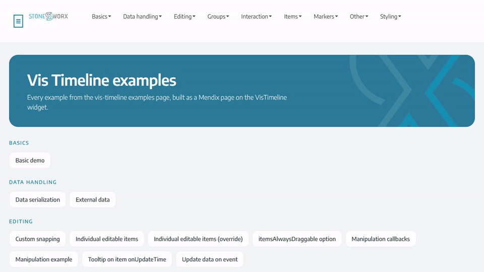

[Try the live demo](https://vistimeline-sandbox.mxapps.io) ·
[Watch the walkthrough as a video (MP4, 1 min)](images/demo.mp4)

## Features

-   **Items** from any data source, with per item start/end, group, subgroup, type (box, point, range, background),
    class name, inline style, alignment, tooltip, order value, selectability and editability.
-   **Groups** with nesting through a self reference set, tree levels, visibility, expand state, ordering, subgroups and
    subgroup visibility.
-   **Templates**: item content, the visible frame of a range item, the group label and the tooltip can each be built
    from any Mendix widgets, rendered through React portals into the elements vis-timeline owns.
-   **Markers**: the current time bar plus a data source of draggable custom time bars, each with its own tooltip, CSS
    class and an optional label on the bar that the user can type in.
-   **Time axis**: visible window, min/max limits, fixed scale and step, custom moment.js label formats, week scale,
    locale and locale label overrides, a fixed time zone offset, hidden periods and rolling mode.
-   **Interaction**: selection (single, multi, per group, sequential) through the Mendix selection property or a two way
    bound attribute, move and zoom limits, zoom key, horizontal and vertical scrolling, click to use and clustering.
-   **Editing**: add, remove, drag in time, drag between groups, group add/remove/reorder, snapping to nice values or to
    a fixed number of minutes, and manipulation callbacks that hand the change to a microflow. Editing is on by default;
    switch each kind off with its expression.
-   **Events**: click, double click, context menu, item hover in/out, external drop, selection change, window change,
    items in view, initial draw, marker move and marker label change, and the full set of item and group manipulation
    events - at widget level with the ids, or bound to the items data source so the microflow receives the object.
-   **Control from a microflow**: a `Command` attribute for the imperative API (fit, focus, zoom, move, set window,
    rolling mode).
-   **Escape hatches**: extra options as JSON, data attributes, and an XSS protection switch for HTML content.
-   A design-mode preview in Studio Pro, and Studio Pro hides the properties that do not apply to the choices you made.

## Requirements

Mendix 10.21 or later: the actions pass their values as action variables, which Mendix added in 10.21. The widget is
built with the Mendix 11 widget tools and has been tested with Mendix 11.12.5. Building it from source needs Node 20 or
later.

## Usage

1. Place the widget on a page inside a data view.
2. Under **Items**, pick the data source and map at least **Item ID** and **Start**.
3. Optionally add a **Groups** data source and map **Group ID**; point **Item Group ID** at the same value so items land
   in the right row.
4. Configure the rest from the property tabs. Studio Pro hides the properties that do not apply to the choices you made
   and reports the combinations that cannot work. Every property is listed under [Properties](#properties).

### Identifiers

All ids (items, groups, subgroups, markers) are normalised to strings, so an Integer group id and a String item group id
still match each other. Ids are also reported back to microflows as strings.

### Controlling the timeline from a microflow

Write one of these values into the attribute bound to **Command** (Advanced → Control). The widget runs it and clears
the attribute again, so the same command can be used twice in a row.

| Command                            | Effect                                            |
| ---------------------------------- | ------------------------------------------------- |
| `fit`                              | Move the window so all items fit                  |
| `redraw`                           | Force a redraw                                    |
| `zoomIn` / `zoomOut`               | Zoom by 50%, or by `zoomIn:0.2`                   |
| `moveLeft` / `moveRight`           | Move by 20% of the window, or by `moveLeft:0.5`   |
| `toggleRollingMode`                | Turn rolling mode on or off                       |
| `focus:<id>`                       | Centre on one item, or several with `focus:1,2,3` |
| `focusSelection`                   | Centre on the current selection                   |
| `moveTo:<ISO date>`                | Centre on a moment in time                        |
| `setWindow:<ISO start>\|<ISO end>` | Set both bounds at once                           |

When rolling mode is on, `fit`, `focus`, `focusSelection`, `moveTo`, `setWindow` and the move commands turn it off
first, since the rolling window would otherwise pull the view straight back to the current time. The zoom commands keep
it on.

### Selection

There are two ways in, and they can be used together:

-   **Selection** (Interaction → Selection) is the Mendix selection property, bound to the items data source. It deals
    in objects, so a microflow or another widget on the page gets the item objects themselves. Choosing _Multi_ also
    switches multi select on.
-   **Selected item IDs** is a two way bound attribute holding the comma separated ids. Writing to it from a microflow
    changes the selection.

When both are bound, Selection decides what is shown as selected and the attribute is kept up to date alongside it.

### Actions that receive the object

The actions under **Events → Item** are bound to the items data source, so the microflow or page they call gets the item
object as its parameter - no retrieve from an id needed. **On item moved** also receives the new start, end and group,
so the drag can be written straight onto the object.

Their counterparts under **Events → Mouse** and **Events → Item manipulation** stay id based and still fire, which is
what a page needs when it reacts to a click on the background or the axis rather than on an item. Binding both means
both run.

### Editing behaviour

The **Editing** tab's _Allow add_, _Allow remove_, _Allow drag in time_, _Allow drag between groups_, _Allow add group_,
_Allow remove group_, _Allow reorder groups_ and _Apply snapping?_ are expressions that default to `true`, so a new
timeline is editable straight away. Set one to `false`, or to an expression such as `$currentObject/IsLocked = false`,
to switch it off. Per item editability attributes win over these settings unless **Timeline settings override items** is
on.

vis-timeline expects an answer while the user is still dragging, which a Mendix action cannot give. The three **Editing
→ Behaviour** properties decide what happens in the meantime:

-   _On add_: discard the drawn item and let the action create it through the data source (default), or keep it on
    screen and call the action.
-   _On move_: keep the new position and call the action (default), or revert and let the action move it through the
    data source.
-   _On remove_: keep the item until the action deletes it through the data source (default), or remove it immediately
    and call the action.

_On update_ always cancels the inline edit and calls the action, so the item can be edited on a page or in a microflow.

Reordering groups by dragging needs **Group order** set to _Order value_. The widget swaps the two order values and
calls **On group order swap** with both new values, so they can be persisted.

### Templates

Set **Content type** (or **Group content type**, **Tooltip type**) to _Custom_ and drop any widgets into the drop zone
that appears. They are rendered per row with the row's object in context, so data views, images, progress bars and
buttons all work. Plain HTML in an attribute works too, but only when **Disable XSS protection** is on - and only for
content you fully control.

### Click events

Clicking empty space, the time axis or a group label is still a click as far as vis-timeline is concerned. **On click
fires for** (and its double click and context menu counterparts) decides whether the action runs there too. The default
for click and double click, _Items and markers_, means the action can count on an item ID or a marker ID being filled
in; for the context menu the default is _Items only_. _Anywhere on the timeline_ reports every click, with empty IDs and
the kind of thing that was hit in the `what` variable - that is what the Event listeners example of vis-timeline does.

**On select** always fires, including when the selection is cleared, so the selected IDs can be empty there.

### Fitting the window

**Fit to items** decides when the window is moved to contain all items: never, on first load (default) or on every data
change. The fit waits for a layout pass, because vis-timeline derives the window from the _rendered_ width of the items.
When some of those items sit in a collapsed nested group vis-timeline cannot measure them and refuses to fit at all, so
the widget falls back to the plain date range of the data plus a small margin.

### Extra options

Anything not exposed as a property can be passed as JSON through **Advanced → Extra options (JSON)**. It is deep merged
into the options after everything else, so a single nested value can be overridden without losing its siblings:

```json
{ "orientation": { "axis": "top" }, "margin": { "item": { "vertical": 2 } } }
```

JSON cannot carry functions. The options that only accept a function are covered by dedicated properties instead:
snapping (**Snap to minutes**), item ordering (**Order value**), group ordering (**Group order**), subgroup ordering
(**Subgroup order field**) and the manipulation callbacks.

### Drag and drop onto the timeline

vis-timeline only reports a drop when the dragged element carries JSON with a `content` field. A Mendix page cannot set
drag data, so the widget does it: any element with `draggable="true"` and a `data-vis-timeline-item` attribute becomes a
drag source, and the attribute value is handed over as the drag data. With the HTML element widget that is two
attributes, for example `data-vis-timeline-item` = `{"type": "range", "content": "New task"}`.

From your own JavaScript the same works directly:

```js
event.dataTransfer.setData("text", JSON.stringify({ content: "New task", target: "item" }));
```

The raw JSON is handed to **On drop** together with the time and group it was dropped on. When **Editable: add** is on,
the drop also runs **On add**, whose **Content** variable carries the dropped item's content.

### What is in view

**On items in view changed** reports the ids of the items and of the groups inside the visible window, after moving,
zooming, scrolling or a data change. Only an actual change runs the action, so a microflow that updates the page from it
does not trigger itself again.

### Marker labels

**Marker label** puts text on the bar itself, as vis-timeline's custom time markers do; **Marker tooltip** stays the
hover text. Map **Marker label editable** to a Boolean to let the user type in the label. Every keystroke runs **On
marker label changing** and leaving the label runs **On marker label changed**, both with the marker id and the plain
text of the label; store the text in the attribute behind the label to keep it. A label the user is typing in is never
rebuilt from Mendix data, so the caret stays put while those actions run.

**On click** and **On double click** also report the id of the marker that was hit, which is what the vis-timeline
example of adding a marker on double click and removing it on a second double click needs.

## Properties

The widget has 176 properties, on the same tabs as in Studio Pro. Expand a tab to see its properties, their defaults
and, for actions, the variables they pass. Properties whose type is an expression accept a constant such as `true` or
`'300px'` as well as an expression over the data view's object.

<details>
<summary><b>Items</b> (24 properties)</summary>

#### Items → Data source

| Property         | Type                                                   | Default | Description                                                                                                          |
| ---------------- | ------------------------------------------------------ | ------- | -------------------------------------------------------------------------------------------------------------------- |
| Items            | Data source                                            |         | The list of objects rendered as items on the timeline. **Required.**                                                 |
| Item ID          | Attribute (String, Integer, Long, AutoNumber, Decimal) |         | Unique identifier of the item. Used to match selections, events and group references. **Required.**                  |
| Start            | Attribute (DateTime)                                   |         | Start date of the item. **Required.**                                                                                |
| End              | Attribute (DateTime)                                   |         | End date of the item. Leave empty for box and point items.                                                           |
| Item Group ID    | Attribute (String, Integer, Long, AutoNumber, Decimal) |         | Must match the Group ID of the group the item belongs to.                                                            |
| Item Subgroup ID | Attribute (String, Integer, Long, AutoNumber, Decimal) |         | Places the item in a subgroup, a stacked lane inside its group.                                                      |
| Order value      | Attribute (Integer, Long, Decimal)                     |         | Sorts items within a group, lowest first. Also usable as the group's Subgroup order field under the name orderValue. |

#### Items → Content

| Property              | Type               | Default     | Description                                                                                                                                                                                                   |
| --------------------- | ------------------ | ----------- | ------------------------------------------------------------------------------------------------------------------------------------------------------------------------------------------------------------- |
| Content type          | Enumeration        | `Attribute` | Attribute renders plain text, or HTML when XSS protection is disabled. Custom renders the widgets you drop below, so any Mendix widget can be used as an item template. Options: Attribute, Custom (widgets). |
| Content               | Attribute (String) |             | Label shown on the item.                                                                                                                                                                                      |
| Content widgets       | Widgets            |             | Rendered inside every item when Content type is Custom.                                                                                                                                                       |
| Visible frame widgets | Widgets            |             | Rendered in the visible part of a range item, so the content stays readable when the item is scrolled partly out of view.                                                                                     |

#### Items → Item styling

| Property   | Type                     | Default | Description                                                                                                                            |
| ---------- | ------------------------ | ------- | -------------------------------------------------------------------------------------------------------------------------------------- |
| Type       | Attribute (Enum, String) |         | box, point, range or background. Falls back to the default item type when empty.                                                       |
| Class name | Attribute (String)       |         | CSS class names added to the item element.                                                                                             |
| Style      | Attribute (String)       |         | Inline CSS applied to the item element, for example: color: white; background-color: red;                                              |
| Align      | Attribute (Enum, String) |         | Alignment of the content inside the item: auto, center, left or right.                                                                 |
| Limit size | Attribute (Boolean)      |         | When false the item element is not clipped to the visible window. Needed for very wide range items with absolutely positioned content. |

#### Items → Item tooltip

| Property        | Type          | Default | Description                                                                                                                           |
| --------------- | ------------- | ------- | ------------------------------------------------------------------------------------------------------------------------------------- |
| Tooltip type    | Enumeration   | `None`  | Choose between no tooltip, a text template, or any Mendix widgets as tooltip content. Options: None, Text template, Custom (widgets). |
| Tooltip text    | Text template |         | Tooltip content shown when hovering the item.                                                                                         |
| Tooltip widgets | Widgets       |         | Rendered inside the tooltip when Tooltip type is Custom.                                                                              |

#### Items → Item editability

| Property               | Type                | Default | Description                                                                                                 |
| ---------------------- | ------------------- | ------- | ----------------------------------------------------------------------------------------------------------- |
| Editable               | Attribute (Boolean) |         | Overrides the timeline wide editability for this item. Ignored when Timeline settings override items is on. |
| Editable: update time  | Attribute (Boolean) |         | Allows dragging this item horizontally.                                                                     |
| Editable: update group | Attribute (Boolean) |         | Allows dragging this item to another group.                                                                 |
| Editable: remove       | Attribute (Boolean) |         | Allows deleting this item.                                                                                  |
| Selectable             | Attribute (Boolean) |         | When false this item cannot be selected.                                                                    |

</details>

<details>
<summary><b>Groups</b> (20 properties)</summary>

#### Groups → Data source

| Property      | Type                                                   | Default | Description                                                                       |
| ------------- | ------------------------------------------------------ | ------- | --------------------------------------------------------------------------------- |
| Groups        | Data source                                            |         | Optional list of objects rendered as rows. Leave empty for an ungrouped timeline. |
| Group ID      | Attribute (String, Integer, Long, AutoNumber, Decimal) |         | Unique identifier of the group. Items refer to it through Item Group ID.          |
| Nested groups | Association                                            |         | Self reference set pointing at the child groups of this group.                    |
| Tree level    | Attribute (Integer, Long)                              |         | Nesting depth of the group, starting at 1 for root groups.                        |

#### Groups → Group content

| Property              | Type               | Default     | Description                                                                                                                                             |
| --------------------- | ------------------ | ----------- | ------------------------------------------------------------------------------------------------------------------------------------------------------- |
| Group content type    | Enumeration        | `Attribute` | Attribute renders plain text, or HTML when XSS protection is disabled. Custom renders the widgets you drop below. Options: Attribute, Custom (widgets). |
| Group content         | Attribute (String) |             | Label shown in the group column.                                                                                                                        |
| Group content widgets | Widgets            |             | Rendered inside every group label when Group content type is Custom.                                                                                    |
| Group tooltip         | Text template      |             | Tooltip shown when hovering the group label.                                                                                                            |

#### Groups → Group styling

| Property           | Type                | Default | Description                                               |
| ------------------ | ------------------- | ------- | --------------------------------------------------------- |
| Group class name   | Attribute (String)  |         | CSS class names added to the group row.                   |
| Group style        | Attribute (String)  |         | Inline CSS applied to the group row.                      |
| Group visible      | Attribute (Boolean) |         | Hides the group row when false. Defaults to visible.      |
| Show nested groups | Attribute (Boolean) |         | Whether this group starts expanded. Defaults to expanded. |

#### Groups → Group ordering

| Property             | Type                               | Default             | Description                                                                                                 |
| -------------------- | ---------------------------------- | ------------------- | ----------------------------------------------------------------------------------------------------------- |
| Order value          | Attribute (Integer, Long, Decimal) |                     | Numeric value the groups are sorted by when Group order is set to Order value.                              |
| Group order          | Enumeration                        | `Data source order` | Sorting applied to the group rows. Options: Data source order, Order value, Content.                        |
| Subgroup order field | Attribute (String)                 |                     | Name of the item field the subgroups of this group are sorted by, for example orderValue, start or content. |
| Stack subgroups      | Attribute (Boolean)                |                     | Whether items inside the subgroups of this group are stacked.                                               |

#### Groups → Subgroups

| Property           | Type                                                   | Default | Description                                                              |
| ------------------ | ------------------------------------------------------ | ------- | ------------------------------------------------------------------------ |
| Subgroups          | Data source                                            |         | Optional list describing the subgroups, used to toggle their visibility. |
| Subgroup: group ID | Attribute (String, Integer, Long, AutoNumber, Decimal) |         | The Group ID this subgroup belongs to.                                   |
| Subgroup ID        | Attribute (String, Integer, Long, AutoNumber, Decimal) |         | Must match the Item Subgroup ID of the items in this subgroup.           |
| Subgroup visible   | Attribute (Boolean)                                    |         | Hides all items of this subgroup when false.                             |

</details>

<details>
<summary><b>Markers</b> (8 properties)</summary>

#### Markers → Current time

| Property          | Type       | Default | Description                                                     |
| ----------------- | ---------- | ------- | --------------------------------------------------------------- |
| Show current time | Boolean    | `true`  | Draws a vertical bar at the current time, updated every second. |
| Current time      | Expression |         | Overrides the browser clock, for example to follow server time. |

#### Markers → Custom time bars

| Property              | Type                                                   | Default | Description                                                                                                                                                         |
| --------------------- | ------------------------------------------------------ | ------- | ------------------------------------------------------------------------------------------------------------------------------------------------------------------- |
| Markers               | Data source                                            |         | Optional list of draggable vertical time bars.                                                                                                                      |
| Marker ID             | Attribute (String, Integer, Long, AutoNumber, Decimal) |         | Unique identifier of the marker. It is also added as a CSS class on the bar, so markers can be styled individually.                                                 |
| Marker time           | Attribute (DateTime)                                   |         | Position of the marker on the time axis.                                                                                                                            |
| Marker tooltip        | Text template                                          |         | Tooltip shown when hovering the marker.                                                                                                                             |
| Marker label          | Text template                                          |         | Text shown on the bar itself, at the top of the timeline. Leave empty for a plain bar.                                                                              |
| Marker label editable | Attribute (Boolean)                                    |         | Lets the user type in the label. The text is handed to On marker label changing and On marker label changed; store it in the attribute behind the label to keep it. |

</details>

<details>
<summary><b>Appearance</b> (25 properties)</summary>

#### Appearance → Size

| Property       | Type       | Default | Description                                                                          |
| -------------- | ---------- | ------- | ------------------------------------------------------------------------------------ |
| Height         | Expression |         | CSS height of the timeline, for example '400px'. Leave empty to size to the content. |
| Minimum height | Expression |         | CSS minimum height, for example '200px'.                                             |
| Maximum height | Expression |         | CSS maximum height, for example '600px'. Combine with vertical scrolling.            |
| Width          | Expression |         | CSS width of the timeline, for example '100%'.                                       |
| Auto resize    | Boolean    | `true`  | Automatically redraw when the container is resized.                                  |

#### Appearance → Layout

| Property                | Type        | Default  | Description                                                                                                                                                |
| ----------------------- | ----------- | -------- | ---------------------------------------------------------------------------------------------------------------------------------------------------------- |
| Axis orientation        | Enumeration | `Bottom` | Where the time axis is drawn. Options: Top, Bottom, Both, None.                                                                                            |
| Item orientation        | Enumeration | `Bottom` | Whether items are aligned to the top or the bottom of their row. Options: Top, Bottom.                                                                     |
| Content alignment       | Enumeration | `Auto`   | Default alignment of content inside items. Options: Auto, Center, Left, Right.                                                                             |
| Default item type       | Enumeration | `Auto`   | Item type used for items that do not specify one. Auto means box without an end date and range with one. Options: Auto, Box, Point, Range, Background.     |
| Stack items             | Boolean     | `true`   | Move overlapping items so they do not cover each other.                                                                                                    |
| Stack subgroups         | Boolean     | `true`   | Stack the subgroups within each group.                                                                                                                     |
| Group height mode       | Enumeration | `Auto`   | Auto sizes each group to its content, Fixed gives every group the same height, Fit items sizes to the visible items only. Options: Auto, Fixed, Fit items. |
| Margin: axis            | Integer     | `20`     | Minimum distance in pixels between items and the time axis.                                                                                                |
| Margin: item horizontal | Integer     | `10`     | Minimum horizontal distance in pixels between items.                                                                                                       |
| Margin: item vertical   | Integer     | `10`     | Minimum vertical distance in pixels between items.                                                                                                         |
| Right to left           | Boolean     | `false`  | Render the timeline right to left.                                                                                                                         |

#### Appearance → Labels and tooltips

| Property                       | Type        | Default | Description                                                                           |
| ------------------------------ | ----------- | ------- | ------------------------------------------------------------------------------------- |
| Show major labels              | Boolean     | `true`  | Show the upper row of the time axis.                                                  |
| Show minor labels              | Boolean     | `true`  | Show the lower row of the time axis.                                                  |
| Show week scale                | Boolean     | `false` | Add a calendar week number scale to the time axis.                                    |
| Maximum minor label characters | Integer     | `7`     | Character width used to decide when the axis switches to a coarser scale.             |
| Show tooltips                  | Boolean     | `true`  | Show the item tooltip on hover.                                                       |
| Tooltip follows mouse          | Boolean     | `false` | Move the tooltip along with the cursor instead of pinning it to the item.             |
| Tooltip overflow               | Enumeration | `Flip`  | How a tooltip that does not fit the window is repositioned. Options: Cap, Flip, None. |
| Tooltip delay                  | Integer     | `500`   | Delay in milliseconds before the tooltip appears.                                     |
| Tooltip while dragging         | Boolean     | `false` | Show the item dates in a tooltip while the item is being dragged or resized.          |

</details>

<details>
<summary><b>Time axis</b> (19 properties)</summary>

#### Time axis → Visible window

| Property     | Type        | Default         | Description                                                                                                 |
| ------------ | ----------- | --------------- | ----------------------------------------------------------------------------------------------------------- |
| Window start | Expression  |                 | Start of the visible window. The window is moved whenever this value changes.                               |
| Window end   | Expression  |                 | End of the visible window. The window is moved whenever this value changes.                                 |
| Fit to items | Enumeration | `On first load` | When the visible window is adjusted to contain all items. Options: Never, On first load, Every data change. |
| Minimum date | Expression  |                 | The timeline cannot be moved before this date.                                                              |
| Maximum date | Expression  |                 | The timeline cannot be moved beyond this date.                                                              |

#### Time axis → Scale

| Property            | Type        | Default | Description                                                                                                                                                     |
| ------------------- | ----------- | ------- | --------------------------------------------------------------------------------------------------------------------------------------------------------------- |
| Fixed scale         | Enumeration | `Auto`  | Forces a fixed scale on the time axis instead of adapting to the zoom level. Options: Auto, Millisecond, Second, Minute, Hour, Weekday, Day, Week, Month, Year. |
| Fixed scale step    | Integer     | `1`     | Step size of the fixed scale, for example 5 with scale Minute.                                                                                                  |
| Minor label formats | Expression  |         | JSON object with moment.js formats per scale, for example {"weekday":"ddd D","day":"D"}.                                                                        |
| Major label formats | Expression  |         | JSON object with moment.js formats per scale, for example {"day":"MMMM YYYY"}.                                                                                  |

#### Time axis → Localization

| Property          | Type       | Default | Description                                                                                             |
| ----------------- | ---------- | ------- | ------------------------------------------------------------------------------------------------------- |
| Locale            | Expression |         | moment.js locale code, for example 'nl' or 'de'. Leave empty for English.                               |
| Label for current | Expression |         | Overrides the word shown on the current time bar tooltip.                                               |
| Label for time    | Expression |         | Overrides the word shown on custom time bar tooltips.                                                   |
| Time zone offset  | Expression |         | Renders all dates in a fixed offset instead of the browser time zone, for example '+05:30' or '-08:00'. |

#### Time axis → Hidden periods

| Property             | Type                     | Default | Description                                                                            |
| -------------------- | ------------------------ | ------- | -------------------------------------------------------------------------------------- |
| Hidden periods       | Data source              |         | Optional list of periods that are cut out of the timeline, such as weekends or nights. |
| Hidden period start  | Attribute (DateTime)     |         | Start of the hidden period.                                                            |
| Hidden period end    | Attribute (DateTime)     |         | End of the hidden period.                                                              |
| Hidden period repeat | Attribute (Enum, String) |         | Empty, daily, weekly, monthly or yearly.                                               |

#### Time axis → Rolling mode

| Property            | Type    | Default | Description                                                          |
| ------------------- | ------- | ------- | -------------------------------------------------------------------- |
| Rolling mode        | Boolean | `false` | Keep the current time in view and scroll the window along with it.   |
| Rolling mode offset | Decimal | `0.5`   | Horizontal position of the current time, from 0 (left) to 1 (right). |

</details>

<details>
<summary><b>Interaction</b> (24 properties)</summary>

#### Interaction → Selection

| Property               | Type               | Default | Description                                                                                                                                                                                                                         |
| ---------------------- | ------------------ | ------- | ----------------------------------------------------------------------------------------------------------------------------------------------------------------------------------------------------------------------------------- |
| Selectable             | Boolean            | `true`  | Allow items to be selected.                                                                                                                                                                                                         |
| Multi select           | Boolean            | `false` | Allow selecting multiple items with ctrl or shift.                                                                                                                                                                                  |
| Multi select per group | Boolean            | `false` | Restrict a multi selection to items in the same group.                                                                                                                                                                              |
| Sequential selection   | Boolean            | `false` | Only allow selecting items that are adjacent in time.                                                                                                                                                                               |
| Long press time        | Integer            | `251`   | Milliseconds a touch must be held before it counts as a selection.                                                                                                                                                                  |
| Selected item IDs      | Attribute (String) |         | Two way bound, comma separated list of selected item IDs. Write to it to change the selection from a microflow.                                                                                                                     |
| Selection              | Selection          | `None`  | Binds the selection to the item objects themselves, so a microflow or another widget on the page works with the objects rather than with a list of ids. Choosing Multi also switches multi select on. Options: None, Single, Multi. |
| Focus on selection     | Boolean            | `false` | Move the window to the selected items when the selection is set from Mendix.                                                                                                                                                        |

#### Interaction → Move and zoom

| Property                 | Type        | Default | Description                                                                                          |
| ------------------------ | ----------- | ------- | ---------------------------------------------------------------------------------------------------- |
| Moveable                 | Boolean     | `true`  | Allow dragging the window.                                                                           |
| Zoomable                 | Boolean     | `true`  | Allow zooming with the scroll wheel or pinch.                                                        |
| Zoom key                 | Enumeration | `None`  | Require this key to be held while scrolling in order to zoom. Options: None, Alt, Ctrl, Shift, Meta. |
| Zoom friction            | Integer     | `5`     | Higher values make zooming slower.                                                                   |
| Minimum zoom interval    | Expression  |         | Smallest visible interval in milliseconds, for example 3600000 for one hour.                         |
| Maximum zoom interval    | Expression  |         | Largest visible interval in milliseconds.                                                            |
| Prefer zoom              | Boolean     | `false` | Zoom instead of scroll when the wheel is used without the zoom key.                                  |
| Horizontal scroll        | Boolean     | `false` | Move the window with the scroll wheel.                                                               |
| Invert horizontal scroll | Boolean     | `false` | Invert the direction of horizontal scrolling.                                                        |
| Vertical scroll          | Boolean     | `false` | Scroll the groups vertically with the scroll wheel. Combine with a maximum height.                   |
| Click to use             | Boolean     | `false` | Only react to mouse and touch events after the timeline has been clicked once.                       |

#### Interaction → Clustering

| Property                    | Type       | Default | Description                                                                |
| --------------------------- | ---------- | ------- | -------------------------------------------------------------------------- |
| Cluster items               | Boolean    | `false` | Merge items that are close together into a single cluster when zoomed out. |
| Cluster maximum items       | Integer    | `5`     | Number of items shown before the rest is clustered.                        |
| Cluster fit on double click | Boolean    | `true`  | Zoom to the contents of a cluster when it is double clicked.               |
| Cluster show stripes        | Boolean    | `false` | Draw a line from a cluster to the items it contains.                       |
| Cluster title template      | Expression |         | Label of a cluster. Use {count} for the number of clustered items.         |

</details>

<details>
<summary><b>Editing</b> (15 properties)</summary>

#### Editing → Items

| Property                         | Type       | Default | Description                                                                                     |
| -------------------------------- | ---------- | ------- | ----------------------------------------------------------------------------------------------- |
| Allow add                        | Expression | `true`  | Allow creating items by double clicking an empty spot.                                          |
| Allow remove                     | Expression | `true`  | Show a delete button on selected items.                                                         |
| Allow drag in time               | Expression | `true`  | Allow dragging and resizing items horizontally.                                                 |
| Allow drag between groups        | Expression | `true`  | Allow dragging items to another group.                                                          |
| Timeline settings override items | Boolean    | `false` | Ignore the per item editability attributes and use these timeline wide settings for every item. |
| Items always draggable           | Boolean    | `false` | Drag items without selecting them first.                                                        |
| Ranges always resizable          | Boolean    | `false` | Resize range items without selecting them first.                                                |

#### Editing → Groups

| Property             | Type       | Default | Description                                                                                        |
| -------------------- | ---------- | ------- | -------------------------------------------------------------------------------------------------- |
| Allow add group      | Expression | `true`  | Allow dragging an item onto the group area to create a group.                                      |
| Allow remove group   | Expression | `true`  | Allow removing groups.                                                                             |
| Allow reorder groups | Expression | `true`  | Allow dragging groups to reorder them. Requires an Order value and Group order set to Order value. |

#### Editing → Snapping

| Property        | Type       | Default | Description                                                                                                |
| --------------- | ---------- | ------- | ---------------------------------------------------------------------------------------------------------- |
| Apply snapping? | Expression | `true`  | Snap dragged items to nice round values. Turn off for free positioning.                                    |
| Snap to minutes | Integer    | `0`     | Snap to a fixed number of minutes, for example 15. Leave at 0 to use the default snapping of vis-timeline. |

#### Editing → Behaviour

| Property            | Type        | Default                                 | Description                                                                                                                                                                                                            |
| ------------------- | ----------- | --------------------------------------- | ---------------------------------------------------------------------------------------------------------------------------------------------------------------------------------------------------------------------- |
| On add behaviour    | Enumeration | `Discard and let the action create it`  | Whether a newly drawn item is kept on screen, or discarded so it can be recreated by the On add action through the data source. Options: Discard and let the action create it, Keep on screen and call the action.     |
| On move behaviour   | Enumeration | `Keep new position and call the action` | Whether a moved item keeps its new position, or snaps back so it can be repositioned by the On move action through the data source. Options: Keep new position and call the action, Revert and let the action move it. |
| On remove behaviour | Enumeration | `Keep and let the action delete it`     | Whether a deleted item disappears immediately, or stays until the On remove action deletes it through the data source. Options: Keep and let the action delete it, Remove immediately and call the action.             |

</details>

<details>
<summary><b>Events</b> (33 properties)</summary>

#### Events → Mouse

| Property                  | Type        | Default             | Description                                                                                                                                                                                                                                                                                                                                                   |
| ------------------------- | ----------- | ------------------- | ------------------------------------------------------------------------------------------------------------------------------------------------------------------------------------------------------------------------------------------------------------------------------------------------------------------------------------------------------------- |
| On click                  | Action      |                     | Triggered when the timeline is clicked. Variables: Clicked item ID (String), Clicked group ID (String), Clicked time (DateTime), Clicked what (String), Clicked marker ID (String).                                                                                                                                                                           |
| On click fires for        | Enumeration | `Items and markers` | Items and markers keeps the action from running when the user clicks empty space, the time axis or a group label, so it can count on an item ID or a marker ID being filled in. Anywhere reports those clicks as well, with empty IDs and the kind of thing that was hit in the "what" variable. Options: Items and markers, Anywhere on the timeline.        |
| On double click           | Action      |                     | Triggered when the timeline is double clicked. Variables: Double clicked item ID (String), Double clicked group ID (String), Double clicked time (DateTime), Double clicked what (String), Double clicked marker ID (String).                                                                                                                                 |
| On double click fires for | Enumeration | `Items and markers` | Items and markers keeps the action from running when the user double clicks empty space, the time axis or a group label, so it can count on an item ID or a marker ID being filled in. Anywhere reports those clicks as well, with empty IDs and the kind of thing that was hit in the "what" variable. Options: Items and markers, Anywhere on the timeline. |
| On context menu           | Action      |                     | Triggered on right click. The browser context menu is suppressed wherever this action fires. Variables: Item ID (String), Group ID (String), Time (DateTime), What (String).                                                                                                                                                                                  |
| On context menu fires for | Enumeration | `Items only`        | Items only keeps the action from running when the user right clicks empty space, the time axis or a group label, so it can count on an item ID being filled in. Anywhere reports those clicks as well, with an empty item ID and the kind of thing that was hit in the "what" variable. Options: Items only, Anywhere on the timeline.                        |
| On item hover             | Action      |                     | Triggered when the mouse enters an item. Use a nanoflow: this runs often, and a run that starts while the previous one is still busy is skipped. Variables: Hovered item ID (String).                                                                                                                                                                         |
| On item hover out         | Action      |                     | Triggered when the mouse leaves an item. Use a nanoflow: this runs often, and a run that starts while the previous one is still busy is skipped. Variables: Unhovered item ID (String).                                                                                                                                                                       |
| On drop                   | Action      |                     | Triggered when an external HTML5 drag and drop payload is dropped on the timeline. Variables: Dropped data (String), Dropped time (DateTime), Dropped group ID (String).                                                                                                                                                                                      |

#### Events → Item

| Property             | Type   | Default | Description                                                                                                                                                                                                                                                              |
| -------------------- | ------ | ------- | ------------------------------------------------------------------------------------------------------------------------------------------------------------------------------------------------------------------------------------------------------------------------ |
| On item click        | Action |         | Triggered when an item is clicked. Receives the item object itself, so the microflow does not have to retrieve it from an id. Receives the item object.                                                                                                                  |
| On item double click | Action |         | Triggered when an item is double clicked. Receives the item object. Receives the item object.                                                                                                                                                                            |
| On item context menu | Action |         | Triggered on right click on an item. Receives the item object. The browser context menu is suppressed wherever this action fires. Receives the item object.                                                                                                              |
| On item update       | Action |         | Triggered when an editable item is double clicked, so it can be edited on a page. Receives the item object. Receives the item object.                                                                                                                                    |
| On item moved        | Action |         | Triggered when an item has been dragged or resized. Receives the item object together with where it was dropped, so the new dates can be written straight onto it. Variables: New start (DateTime), New end (DateTime), New group ID (String). Receives the item object. |
| On item removed      | Action |         | Triggered when the user deletes an item. Receives the item object. Receives the item object.                                                                                                                                                                             |

#### Events → Timeline

| Property                 | Type   | Default | Description                                                                                                                                                                                                                                                                                       |
| ------------------------ | ------ | ------- | ------------------------------------------------------------------------------------------------------------------------------------------------------------------------------------------------------------------------------------------------------------------------------------------------- |
| On select                | Action |         | Triggered when the selection changes by user interaction, including when it is cleared by clicking empty space. Variables: Selected item IDs (String).                                                                                                                                            |
| On window changed        | Action |         | Triggered after the visible window has moved or zoomed. Variables: Window start (DateTime), Window end (DateTime), Changed by user (Boolean).                                                                                                                                                     |
| On items in view changed | Action |         | Triggered when the items or groups inside the visible window change, after moving, zooming, scrolling or a data change. Use a nanoflow: this runs often, and a run that starts while the previous one is still busy is skipped. Variables: Item IDs in view (String), Group IDs in view (String). |
| On initial draw complete | Action |         | Triggered once, when the timeline has been drawn for the first time.                                                                                                                                                                                                                              |
| On marker moving         | Action |         | Triggered continuously while a marker is dragged. Use a nanoflow: this runs often, and a run that starts while the previous one is still busy is skipped. Variables: Marker ID (String), Marker time (DateTime).                                                                                  |
| On marker moved          | Action |         | Triggered when a marker has been dropped at its new time. Variables: Marker ID (String), Marker time (DateTime).                                                                                                                                                                                  |
| On marker label changing | Action |         | Triggered on every keystroke while an editable marker label is typed in. Use a nanoflow: this runs often, and a run that starts while the previous one is still busy is skipped. Variables: Marker ID (String), Marker label (String).                                                            |
| On marker label changed  | Action |         | Triggered when the user leaves an editable marker label after changing it. Variables: Marker ID (String), Marker label (String).                                                                                                                                                                  |

#### Events → Item manipulation

| Property  | Type   | Default | Description                                                                                                                                                                                                                                      |
| --------- | ------ | ------- | ------------------------------------------------------------------------------------------------------------------------------------------------------------------------------------------------------------------------------------------------ |
| On add    | Action |         | Triggered when the user draws a new item. Variables: Added item JSON (String), Start (DateTime), End (DateTime), Group ID (String), Content (String).                                                                                            |
| On update | Action |         | Triggered when an editable item is double clicked, so it can be edited on a page. Variables: Updated item JSON (String), Item ID (String).                                                                                                       |
| On move   | Action |         | Triggered when an item has been dragged or resized to a new position. Variables: Item ID (String), New start (DateTime), New end (DateTime), New group ID (String).                                                                              |
| On moving | Action |         | Triggered continuously while an item is being dragged. Use a nanoflow: this runs often, and a run that starts while the previous one is still busy is skipped. Variables: Item ID (String), Start (DateTime), End (DateTime), Group ID (String). |
| On remove | Action |         | Triggered when the user deletes an item. Variables: Removed item JSON (String), Item ID (String).                                                                                                                                                |

#### Events → Group manipulation

| Property            | Type   | Default | Description                                                                                                                                                                                                                      |
| ------------------- | ------ | ------- | -------------------------------------------------------------------------------------------------------------------------------------------------------------------------------------------------------------------------------- |
| On add group        | Action |         | Triggered when a new group is created. Variables: Added group JSON (String).                                                                                                                                                     |
| On move group       | Action |         | Triggered when a group is moved. Variables: Group ID (String).                                                                                                                                                                   |
| On remove group     | Action |         | Triggered when a group is removed. Variables: Group ID (String).                                                                                                                                                                 |
| On group order swap | Action |         | Triggered when two groups swap places by dragging. Persist both order values to make the new order stick. Variables: Group ID (String), Group order value (Integer), Other group ID (String), Other group order value (Integer). |
| On group dragged    | Action |         | Triggered when a group has been dragged to a new place. Variables: Group ID (String).                                                                                                                                            |

</details>

<details>
<summary><b>Advanced</b> (8 properties)</summary>

#### Advanced → Control

| Property               | Type               | Default            | Description                                                                                                                                                                                                                                                                      |
| ---------------------- | ------------------ | ------------------ | -------------------------------------------------------------------------------------------------------------------------------------------------------------------------------------------------------------------------------------------------------------------------------- |
| Command                | Attribute (String) |                    | Write a command to this attribute to control the timeline from a microflow: fit, redraw, zoomIn, zoomOut, moveLeft, moveRight, toggleRollingMode, focus:<itemId>, moveTo:<ISO date>, setWindow:<ISO start>\|<ISO end>. The widget clears the attribute once the command has run. |
| Animate window changes | Boolean            | `true`             | Animate window, focus and zoom changes triggered from Mendix.                                                                                                                                                                                                                    |
| Animation duration     | Integer            | `500`              | Duration of those animations in milliseconds.                                                                                                                                                                                                                                    |
| Animation easing       | Enumeration        | `Ease in out quad` | Easing function used for those animations. Options: Linear, Ease in quad, Ease out quad, Ease in out quad, Ease in cubic, Ease out cubic, Ease in out cubic, Ease in quart, Ease out quart, Ease in out quart, Ease in quint, Ease out quint, Ease in out quint.                 |

#### Advanced → Escape hatches

| Property               | Type       | Default | Description                                                                                                                    |
| ---------------------- | ---------- | ------- | ------------------------------------------------------------------------------------------------------------------------------ |
| Data attributes        | Expression |         | Copy item fields onto the item element as data- attributes. Use 'all' or a comma separated list such as 'id,start,end'.        |
| Disable XSS protection | Boolean    | `false` | Render item and group content as raw HTML. Only enable this when the content is trusted.                                       |
| Show loading overlay   | Boolean    | `true`  | Dim the timeline and show a spinner while the data sources are loading.                                                        |
| Extra options (JSON)   | Expression |         | JSON object merged into the vis-timeline options after all properties above, for any option that is not exposed as a property. |

</details>

## Demo project

-   [Mendix app running on the cloud](https://vistimeline-sandbox.mxapps.io) (public, no login)

The demo app rebuilds every example of the
[vis-timeline examples page](https://visjs.github.io/vis-timeline/examples/timeline/) as a Mendix page on this widget,
grouped the same way in the navigation menu and on the home page. Each page builds its own sample data in a data source
microflow, so there is nothing to upload. The cloud demo is public, so please be mindful when changing its data, to keep
it working for everyone.

|                                                                                                                                                                        |                                                                                                                                                                 |
| ---------------------------------------------------------------------------------------------------------------------------------------------------------------------- | --------------------------------------------------------------------------------------------------------------------------------------------------------------- |
| 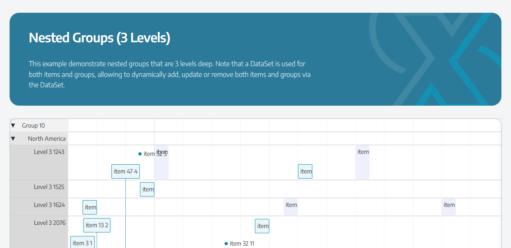 **Nested groups (3 levels)** - a self reference set nests groups, with a tree level per row.  | 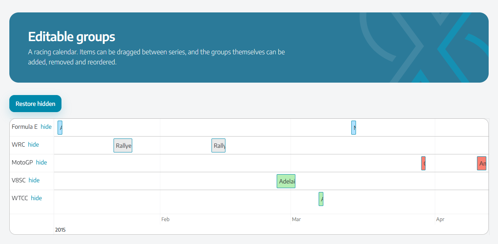 **Editable groups** - items drag between series; groups can be hidden, added, removed and reordered.       |
| 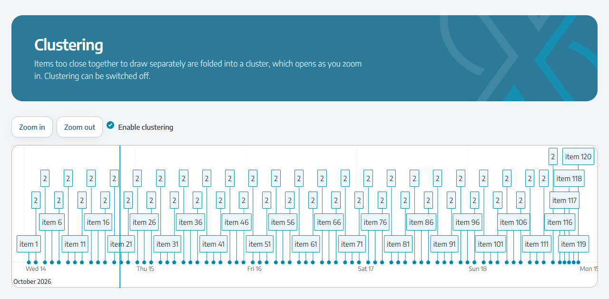 **Clustering** - items too close together fold into a cluster that opens as you zoom in.                                    | 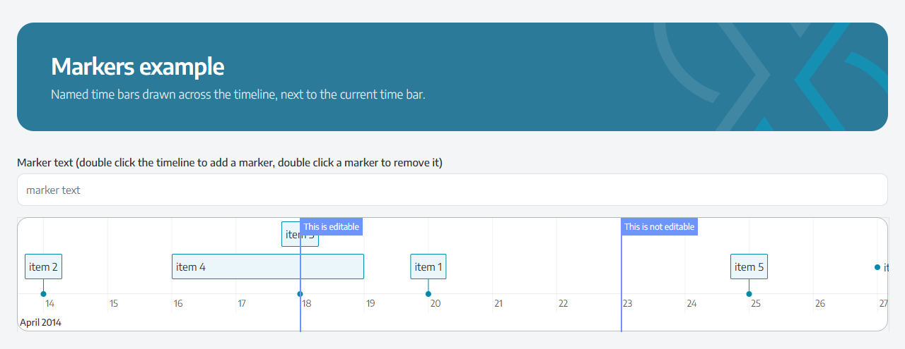 **Markers** - custom time bars from a data source, with a label on the bar the user can edit.                      |
| 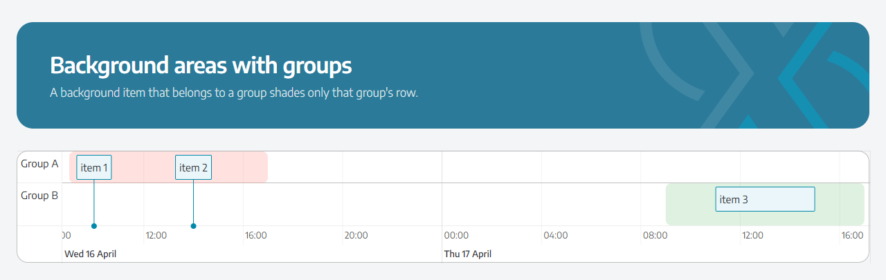 **Background areas** - a background item in a group shades only that row.               | 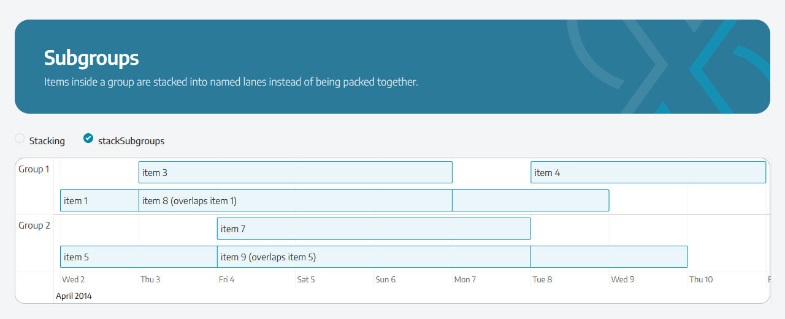 **Subgroups** - items stack into named lanes inside their group.                                                       |
| 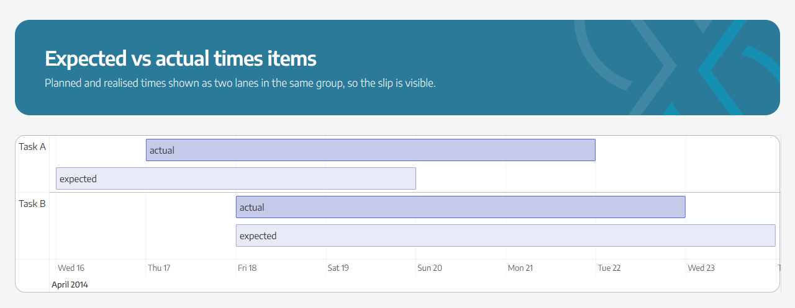 **Expected vs actual** - planned and realised times as two lanes, so the slip is visible. | 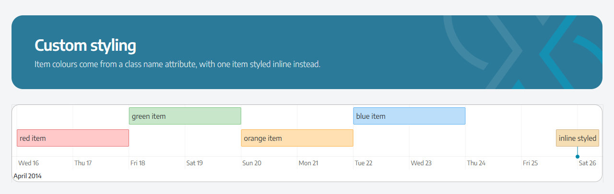 **Custom styling** - colours from a class name attribute, or an inline style.                                |
| 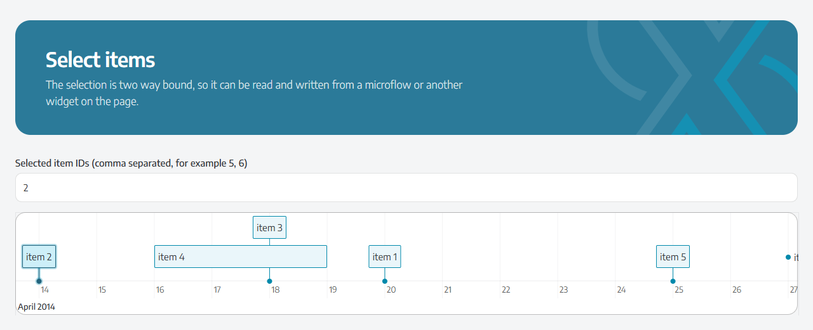 **Selection** - two way bound, so a microflow or another widget can read and set it.                                    | 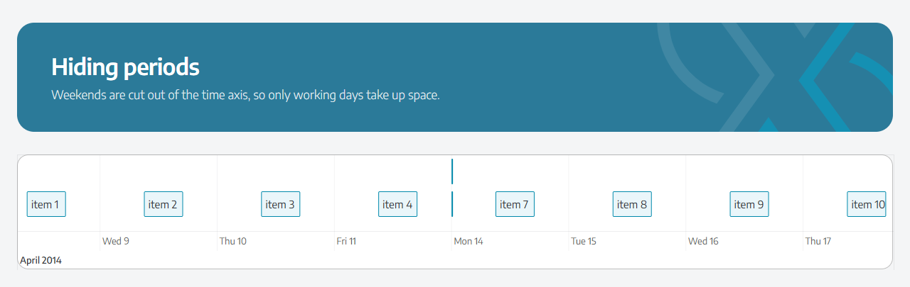 **Hiding periods** - weekends cut out of the time axis by a hidden periods data source.                      |
| 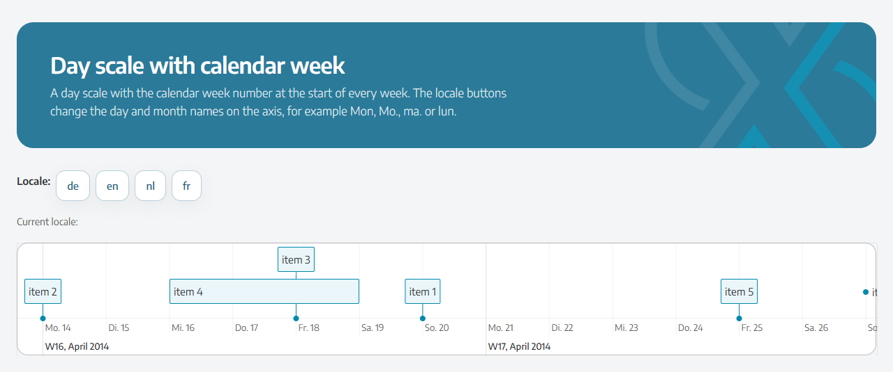 **Localization** - week numbers on the axis, and the locale switched at runtime.        | 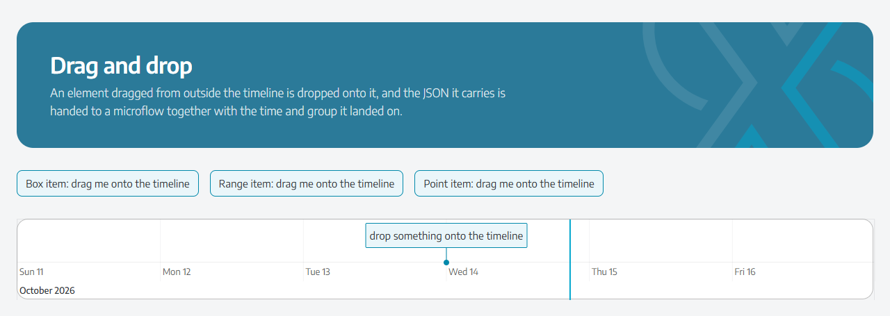 **Drag and drop** - page elements dropped onto the timeline hand their JSON to a microflow.                    |
| 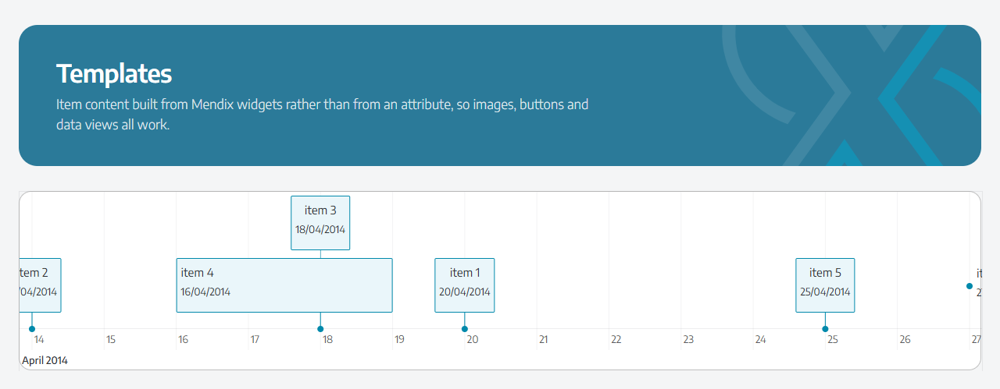 **Templates** - item content built from Mendix widgets instead of an attribute.                                               | 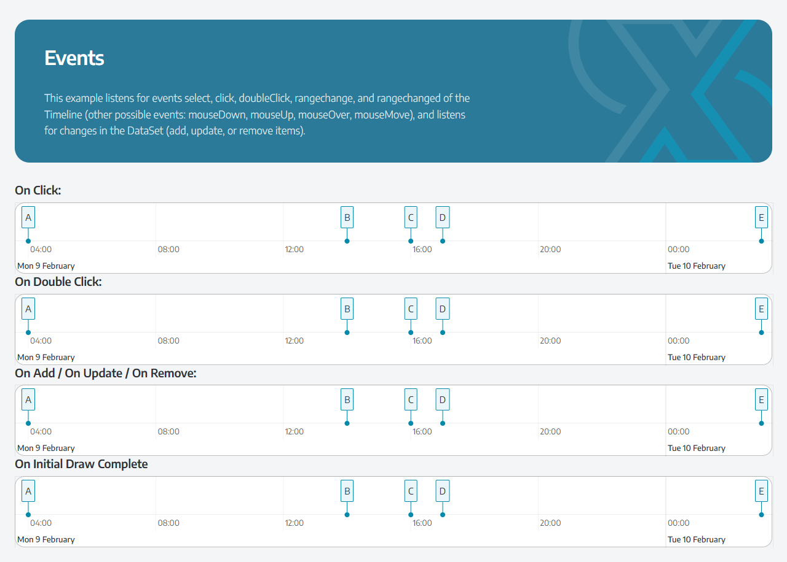 **Event listeners** - click, double click, manipulation and initial draw events, each in its own timeline. |

## Security

-   **Every action variable is client input.** Item and group IDs, dates, `data`, `droppedData` and `addedContent` come
    from the browser and can be crafted, and **On drop** accepts text dragged in from any site. Microflows must check
    access and validate these values, and never commit straight from them. Prefer the actions under **Events → Item**,
    which receive the Mendix object itself.
-   **XSS protection** is on unless the **Disable XSS protection** property turns it off. `xss` in **Extra options
    (JSON)** is ignored, so the JSON cannot switch it off behind the property's back.
-   **Extra options (JSON)** never merges `__proto__`, `constructor` or `prototype` keys.

## Upgrading from the first version

The property keys of the first version are all still there, so existing pages keep their mappings. Three behaviours did
change, and pages built against the old widget need a look:

-   **On update** used to fire whenever the data source changed, which also meant a microflow could trigger itself. It
    now fires only when the user double clicks an editable item.
-   **On add**, **On update** and **On remove** pass the item as a JSON object in `data`. The old widget passed a JSON
    _array_ for add and update, and the bare item id for remove - which is now a separate `Item ID` variable.
-   **Fit to items** defaults to _On first load_. The old widget refitted on every data change, which is the _Every data
    change_ option.

## Examples page coverage

| Example                                                      | Configured with                                               |
| ------------------------------------------------------------ | ------------------------------------------------------------- |
| Basic demo, Data serialization, External data                | Items data source                                             |
| Custom snapping                                              | Apply snapping, Snap to minutes                               |
| Individual editable items (+ override)                       | Item editability attributes, Timeline settings override items |
| itemsAlwaysDraggable                                         | Items always draggable, Ranges always resizable               |
| Manipulation callbacks, Update data on event                 | On add / update / move / moving / remove + Behaviour          |
| Editable groups, Group example, Groups ordering              | Groups data source, Order value, Group order, group editing   |
| Nested groups (2 and 3 levels)                               | Nested groups association, Tree level, Show nested groups     |
| Subgroups, Subgroup visibility                               | Item Subgroup ID, Subgroups data source, Stack subgroups      |
| Visible groups, Vertical items hide                          | Group visible, Maximum height, Vertical scroll                |
| Animate window, navigation menu                              | Window start/end, Command, Animate window changes             |
| Click to use, Limit move and zoom                            | Click to use, Minimum/Maximum date, zoom interval             |
| Select items, Sequential selection, Item selectability       | Selection group, Selectable per item                          |
| Selection driven by another widget on the page               | Selection property bound to the items data source             |
| Event listeners                                              | Events tab                                                    |
| Background areas (+ with groups), Point items                | Type attribute, Default item type                             |
| Dynamic content, HTML data, Templates, React components      | Custom content widgets                                        |
| Tooltips, Tooltip template, onUpdateTime tooltip             | Item tooltip group, Tooltip while dragging                    |
| Item ordering, Range overflow                                | Order value, Limit size                                       |
| Markers, Marker events, Editable markers, Current time       | Markers group, Marker label, On marker label changing/changed |
| A lot of grouped data, performance, Stress performance       | Only changed rows are pushed to vis, clustering               |
| Clustering                                                   | Cluster items and its sub properties                          |
| Custom label format, Show day scale with calendar week       | Minor/Major label formats, Show week scale                    |
| Localization, Custom localization, Time zone, RTL            | Localization group, Right to left                             |
| Data attributes (all)                                        | Data attributes                                               |
| Drag & drop                                                  | On drop, data-vis-timeline-item drag sources                  |
| Hiding periods                                               | Hidden periods data source                                    |
| Horizontal/Vertical/Bi-directional scroll, Invert            | Move and zoom group                                           |
| Loading screen                                               | Show loading overlay, On initial draw complete                |
| Rolling mode                                                 | Rolling mode, Rolling mode offset                             |
| Custom styling, Grid styling, Item class names, Week styling | Class name and Style attributes plus your own CSS             |
| Orientation                                                  | Axis orientation, Item orientation                            |
| Peer/Standalone/require.js builds                            | Not applicable, the widget ships its own bundle               |

## Development and contribution

Install the dependencies with `npm install` (Node 20 or later). Then:

-   `npm start`: watches for code changes and rebuilds the widget into `dist/` and into the `widgets` folder of the
    Mendix app set in `config.projectPath`.
-   `npm run lint`: checks formatting and code style.
-   `npm test`: runs the unit tests.
-   `npm run build`: development build in `dist/<version>/`.
-   `npm run release`: production build in `dist/<version>/stoneworx.VisTimeline.mpk`. Use this one for the Marketplace
    and the demo app.

Run `npm test` for the unit tests. They cover the layer between Mendix and vis-timeline - the data source mapping, the
options, the data set diff, the marker sync and the commands - by feeding the pure functions stand-ins for the Mendix
client values from `src/utils/testUtils.ts`. That is where the bugs live: an id read from the wrong place, a field that
is not cleared, an action that fires when it should not. Anything that needs a real timeline is not covered, so a change
to the React component still wants a look in a running app.

Source layout:

-   `src/VisTimeline.xml` - the property surface; `typings/VisTimelineProps.d.ts` is generated from it.
-   `src/components/VisTimelineComponent.tsx` - the React wrapper that owns the vis-timeline instance.
-   `src/utils/data.ts` - Mendix data sources to vis-timeline items, groups, markers and hidden dates.
-   `src/utils/options.ts` - properties to vis-timeline options.
-   `src/utils/sync.ts` - pushing only what changed into the vis-timeline data sets and markers.
-   `src/utils/actions.ts` - running Mendix actions and mirroring the selection back.
-   `src/utils/commands.ts` - the `Command` attribute.
-   `src/utils/values.ts` - attribute reading, id normalisation and JSON helpers.
-   `src/utils/vis.ts` - the two exports of the standalone build that its type declarations omit.
-   `src/utils/dragSources.ts`, `inView.ts`, `guards.ts` - drag sources without JavaScript, the items in view check, and
    the guards for reloading data sources, the fit fallback and the click scopes.
-   `src/VisTimeline.editorConfig.ts` and `src/VisTimeline.editorPreview.tsx` - which properties Studio Pro shows and
    checks, and the design-mode preview.
-   `src/utils/testUtils.ts` - Mendix client value stand-ins for the tests.
